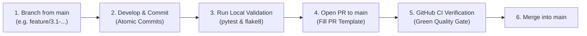

# Engineering Guidelines & Contributing Protocol

Welcome to the **Edge-Native Adaptive Traffic Signal Control** repository. To maintain high code quality, predictability, and stability, all contributors must strictly adhere to the branching, commit, and Pull Request (PR) workflow described below.

---

## 1. Branching Strategy

### The Golden Rule
> **`main` is protected.** No engineer or automated script may push directly to `main` for feature or subtask work. All code must enter `main` exclusively through a Pull Request that has passed the automated CI/CD pipeline.

### Branch Naming Convention
Branches must strictly reflect the milestone hierarchy and subtask number:

| Branch Type | Format Pattern | Example |
| :--- | :--- | :--- |
| **Major Milestone / Epic** | `feature/phase-<number>` | `feature/phase-3-advanced-engineering` |
| **Subtask Feature** | `feature/<phase>.<subtask>-<slug>` | `feature/3.1-ipm-calibration`<br>`feature/3.2-ev-preemption`<br>`feature/3.3-municipal-audit-pdf` |
| **Bug Fix** | `fix/<phase>.<subtask>-<slug>` or `fix/<slug>` | `fix/sumo-flow-guard`<br>`fix/database-init-lock` |
| **Maintenance / CI** | `chore/<slug>` or `ci/<slug>` | `ci/github-actions-pipeline` |

---

## 2. Conventional Commit Standard

All commits must follow the [Conventional Commits](https://www.conventionalcommits.org/) specification:

```
<type>(<scope>): <short imperative description>
```

### Commit Types:
- `feat`: A new feature or analytical capability (e.g., `feat(analysis): implement multi-approach ipm homography store`).
- `fix`: A bug fix (e.g., `fix(sumo): guard against non-positive vehicle flows`).
- `test`: Adding or updating test cases (e.g., `test(preemption): add unit tests for emergency vehicle priority`).
- `refactor`: Code reorganization with no change in external behavior (e.g., `refactor(db): expose digital twin telemetry loggers`).
- `ci`: Changes to CI/CD workflows and automation (e.g., `ci: configure github actions pipeline with sumo and headless pytest`).
- `docs`: Documentation, guides, or comments.
- `chore`: Dependency updates, tooling, or repository housekeeping.

### Atomic Commits Rule:
- Commit **singly and atomically**.
- Do not batch unrelated files together into a single mega-commit.
- Separate implementation from test suites and UI views where appropriate.

---

## 3. Pull Request (PR) Lifecycle

Every feature, subtask, or fix must follow the 5-step lifecycle:



### Local Pre-Flight Check (Run before opening PR):
```powershell
# 1. Run full test suite (all tests must pass)
pytest tests/ -v

# 2. Verify syntax and undefined names
flake8 src tests app --count --select=E9,F63,F7,F82 --show-source --statistics

# 3. Check git status to ensure no untracked/unintended files
git status
```

---

## 4. CI/CD Pipeline Enforcement

On every Pull Request targeting `main`, the GitHub Actions CI pipeline automatically runs:
1. **Lint & Syntax Check:** Flake8 validation preventing broken imports, undefined variables, or syntax errors.
2. **Headless Environment Setup:** Ubuntu runner configured with Eclipse SUMO (`SUMO_HOME=/usr/share/sumo`), headless OpenCV (`OPENCV_VIDEOIO_PRIORITY_MSMF=0`), and headless Matplotlib (`MPLBACKEND=Agg`).
3. **Automated Test Matrix:** Executes all 115+ unit and integration tests across the vision, reinforcement learning, database, SUMO co-simulation, and municipal reporting modules.
4. **Smoke & Artifact Verification:** Exercises vector PDF report compilation and Streamlit module imports.
5. **Quality Gate:** Merge is blocked if any job fails.

---

## 5. Environment & Zero Cloud Cost Policy
- **100% Free & Local:** All capabilities must execute locally without requiring commercial cloud subscriptions, paid SaaS tokens, or external API keys.
- **Python Compatibility:** Tested on Python 3.12.
