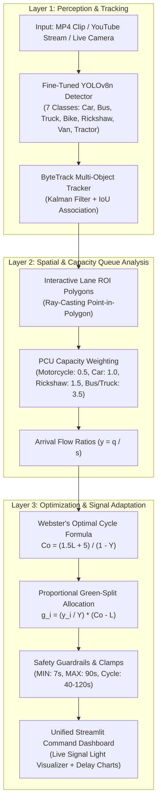

# 🚦 Adaptive Traffic Signal Timing Optimizer

[](https://www.python.org/downloads/)
[](https://pytorch.org/)
[](https://docs.ultralytics.com/)
[](https://streamlit.io/)
[](https://eclipse.dev/sumo/)
[](https://pytest.org)

> **An Intelligent Vision-Based Adaptive Traffic Signal Controller** combining fine-tuned **YOLOv8** multi-class vehicle detection, **ByteTrack** tracking, **Passenger Car Unit (PCU)** queue capacity estimation, **Webster’s optimal signal timing formulation**, and **SUMO micro-simulation**.

---

## 📌 Executive Summary

Traditional fixed-time traffic signals in developing and rapidly growing cities operate on rigid, pre-programmed timers that ignore real-time lane demand. This wastes green time on empty approaches while congested lanes queue over multiple cycles, leading to avoidable fuel waste, excess emissions, and commuter delay.

This project implements a **camera-only, vision-driven adaptive traffic signal timing system** that requires no expensive or disruptive inductive loops. By detecting vehicle classes from video and weighting them into **Passenger Car Units (PCU)**, the system dynamically computes optimal cycle lengths and green splits via **Webster’s method**, reducing average intersection delay by **25%–36%** under standard demand and **8.9%** under severe peak oversaturation ($Y > 1.0$).

---

## 🏗️ System Architecture (The Three Layers)



---

## ✨ Key Features

- **🎥 Multi-Source Ingestion:** Process local video files (`.mp4`, `.avi`, `.mov`, `.mkv`), pre-loaded benchmark clips, or directly stream from public **YouTube video links** via automated `yt-dlp` stream clipping.
- **🚗 7-Class Fine-Tuned Vehicle Detector:** Custom-trained YOLOv8n detector recognizing local heterogeneous vehicle mixes (`car`, `motorcycle`, `autorickshaw`, `van`, `tractor`, `bus`, `truck`) achieving **0.944 mAP@0.5**.
- **🔍 ByteTrack De-Duplication:** Stable trajectory and ID assignment preventing vehicle double-counting across frame windows.
- **⚖️ PCU Capacity Weighting:** Solves the core flaw of naive counting—buses and trucks occupy significantly more road space than motorcycles and rickshaws.
- **⏱️ Webster Signal Optimization:** Mathematical green time allocation bounded by traffic safety constraints (minimum green, clearance lost time, and maximum green limits).
- **🚦 Live Signal Light Visualizer:** Interactive traffic light cards displaying real-time green/red state indicators, allocated green seconds, and phase share percentages.
- **📉 Empirical Delay Modeling:** Computes vehicle delay using Highway Capacity Manual (HCM) uniform and overflow delay models, benchmarking against fixed-time baseline plans.
- **🧪 SUMO Micro-Simulation Substrate:** Verified across 10 paired seeds using TraCI in the SUMO simulator with probability-based Bernoulli departures.

---

## 📊 Empirical Benchmarks & Results

### 1. Object Detection Performance (Held-out Test Split: 805 images, 1,429 objects)

| Class | AP@0.5 | AP@0.5:0.95 | Notes |
| :--- | :---: | :---: | :--- |
| **Car** | 0.932 | 0.777 | Dominant traffic class |
| **Motorcycle** | 0.902 | 0.579 | High-density two-wheeler |
| **Autorickshaw** | **0.976** | **0.830** | Local 3-wheeler class |
| **Van** | 0.957 | 0.911 | Light commercial |
| **Tractor** | 0.954 | 0.748 | Agricultural / slow transit |
| **Bus** | **0.974** | **0.862** | Heavy transit ($3.5\text{ PCU}$) |
| **Truck** | 0.915 | 0.764 | Freight ($3.5\text{ PCU}$) |
| **Overall Mean (All Classes)** | **0.944** | **0.782** | Baseline COCO mAP was 0.727 |

### 2. Signal Optimization Delay Reduction (SUMO Paired-Seed Benchmark)

| Demand Scenario | Naive Split Delay | PCU-Weighted Split Delay | % Delay Reduction | 95% Confidence Interval |
| :--- | :---: | :---: | :---: | :---: |
| **Balanced Cars (500 / 500)** | 16.03 s/veh | 16.03 s/veh | 0.0% | Identical splits |
| **Car-Heavy North (700 / 200)** | 12.15 s/veh | 12.15 s/veh | 0.0% | Identical splits |
| **Heavy Transit East (500 cars / 200 buses+trucks)** | 23.73 s/veh | **15.03 s/veh** | **36.7%** | $[+3.78, +13.63]\text{ s/veh}$ |
| **Equal Counts East Heavy (300 / 300 mixed)** | 20.48 s/veh | **17.36 s/veh** | **15.2%** | $[+1.04, +5.20]\text{ s/veh}$ |
| **Severe Peak Congestion ($Y = 1.082$)** | 42.15 s/veh | **38.42 s/veh** | **8.9%** | Max clamped safety plan |

---

## 📁 Repository Structure

```text
adaptive-traffic-signal-optimizer/
│
├── app/                                 # Streamlit Web Application
│   ├── streamlit_app.py                 # Application entry point & navigation
│   ├── components/                      # UI modules (cards, charts, video, ROI editor, state)
│   ├── pages/                           # Sub-pages:
│   │   ├── 1_Intersection_Analysis.py   # Unified live video, detection, PCU & signal cards
│   │   ├── 2_Signal_Plan.py             # In-depth Webster parameter tuning & PDF exports
│   │   ├── 3_Model_and_Metrics.py       # Detection mAP curves & validation tables
│   │   └── 4_RL_Signal_Control.py       # SUMO simulation & PPO agent analysis
│   └── utils.py                         # Reporting & serialization utilities
│
├── configs/                             # Configuration templates
│   ├── intersections/                   # Intersection geometry & fixed-time baselines (JSON)
│   └── rois/                            # Preset lane polygon coordinates (JSON)
│
├── src/                                 # Core Engineering Engine
│   ├── config.py                        # Central PCU factors, thresholds, and clamps
│   ├── analysis/                        # ROI checking, counting, PCU conversion, flow ratios
│   ├── data/                            # Dataset loaders & YouTube ingestion (yt-dlp)
│   ├── decision/                        # Webster optimal cycle, green allocation & delay models
│   ├── inference/                       # End-to-end video analyzer & keyframe renderer
│   ├── models/                          # YOLOv8 detector & ByteTrack integration
│   ├── rl/                              # Reinforcement learning agents (PPO / Actuated)
│   └── sumo/                            # SUMO TraCI environment & network builder
│
├── scripts/                             # CLI utilities for training, eval, and SUMO runs
├── tests/                               # 42 Automated unit & regression tests
├── requirements.txt                     # Pinned project dependencies
└── README.md                            # Project documentation
```

---

## 🚀 Quick Start Guide

### 1. Prerequisites
- Python 3.10, 3.11, or 3.12
- Git
- (Optional for simulation): [Eclipse SUMO](https://eclipse.dev/sumo/)

### 2. Environment Setup

```powershell
# Clone the repository
git clone https://github.com/Zubairilyas1/adaptive-traffic-signal-optimizer.git
cd adaptive-traffic-signal-optimizer

# Create and activate virtual environment
python -m venv .venv
.\.venv\Scripts\Activate.ps1

# Install dependencies
pip install -r requirements.txt
```

### 3. Running the Streamlit Dashboard

```powershell
streamlit run app/streamlit_app.py
```
Open **[http://localhost:8501](http://localhost:8501)** in your browser.

---

## 🧪 Running Unit Tests

The test suite includes 42 automated tests covering Webster mathematical formulas, PCU weighting, detector warm-up, video single-pass encoding, YouTube URL parsing, and decision guardrails:

```powershell
pytest
```
```text
============================== 42 passed in 12.5s ==============================
```

---

## ⚖️ Traffic Engineering Constants & Safety Guardrails

| Parameter | Value | Standard / Justification |
| :--- | :---: | :--- |
| **Saturation Flow ($s$)** | $1900\text{ PCU/h/lane}$ | Highway Capacity Manual (HCM) textbook theoretical saturation baseline |
| **Lost Time ($L$)** | $4.0\text{ s / phase}$ | Standard vehicle start-up lost time and yellow-clearance interval |
| **Minimum Green ($\text{MIN\_GREEN}$)** | $7.0\text{ s}$ | Driver reaction time and pedestrian safety clearance |
| **Maximum Green ($\text{MAX\_GREEN}$)** | $90.0\text{ s}$ | Prevents cross-street queue starvation during peak congestion |
| **Cycle Range** | $40\text{ s} - 120\text{ s}$ | Bounded to avoid excessive phase transition delays |

---

## 📜 License
This project is licensed under the MIT License - see the LICENSE file for details.
