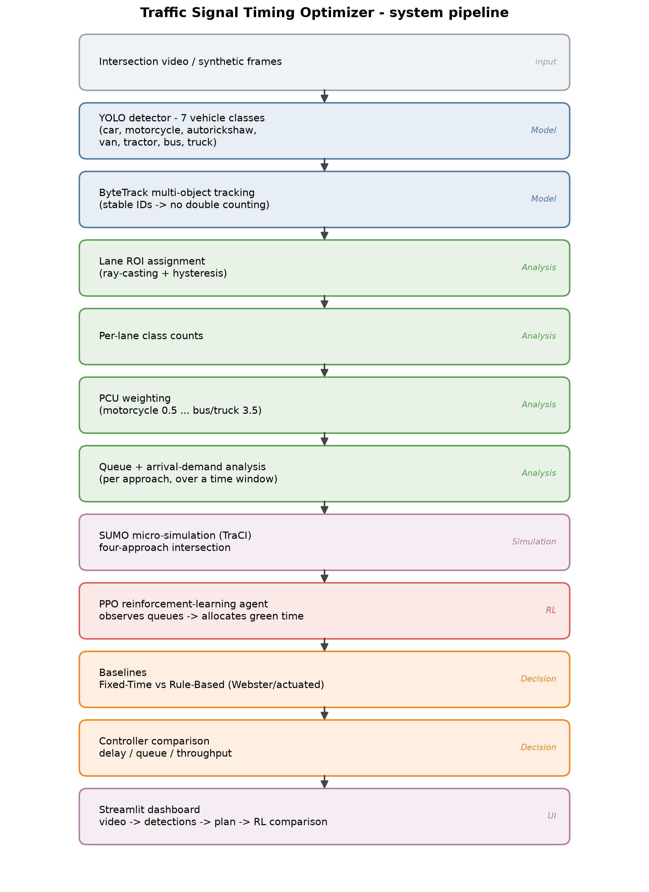
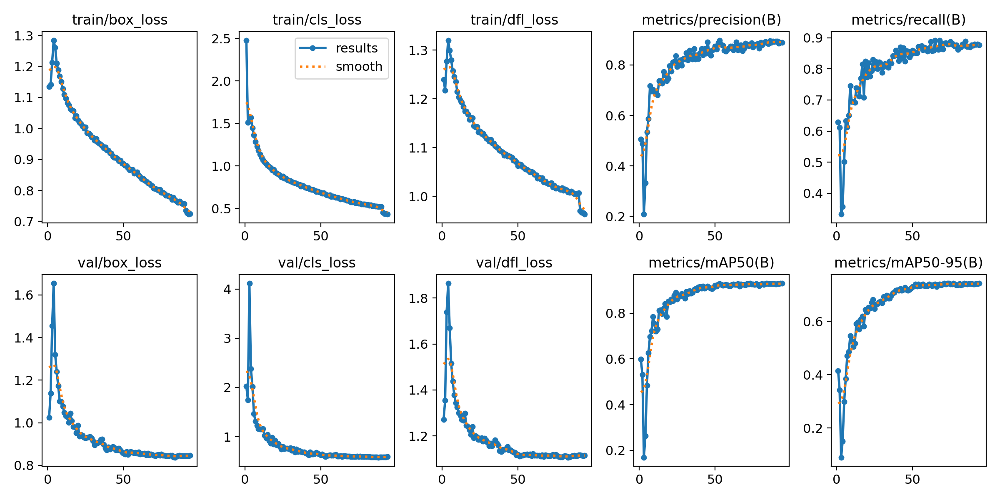
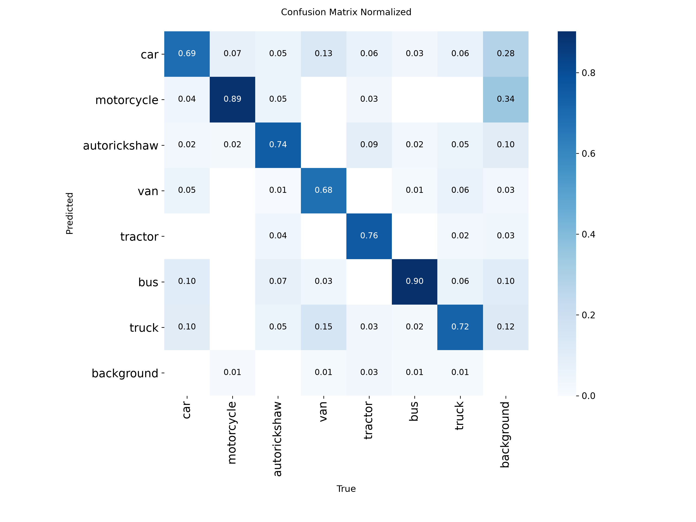
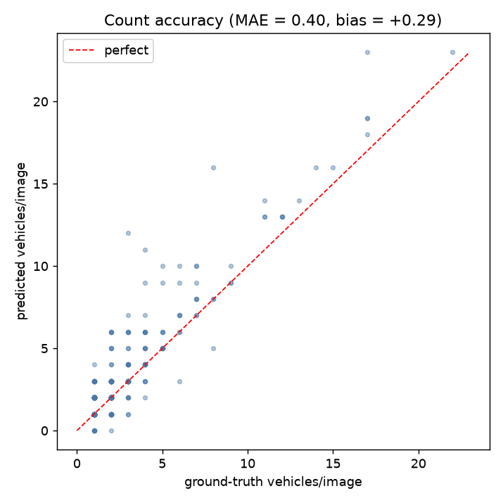
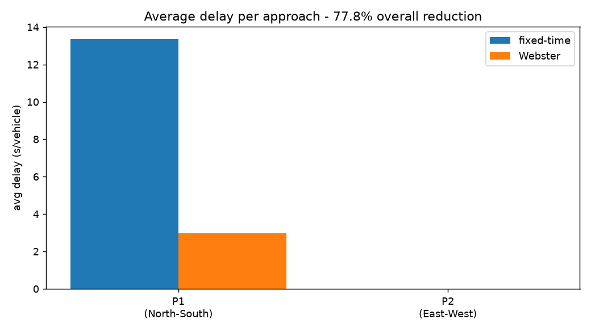
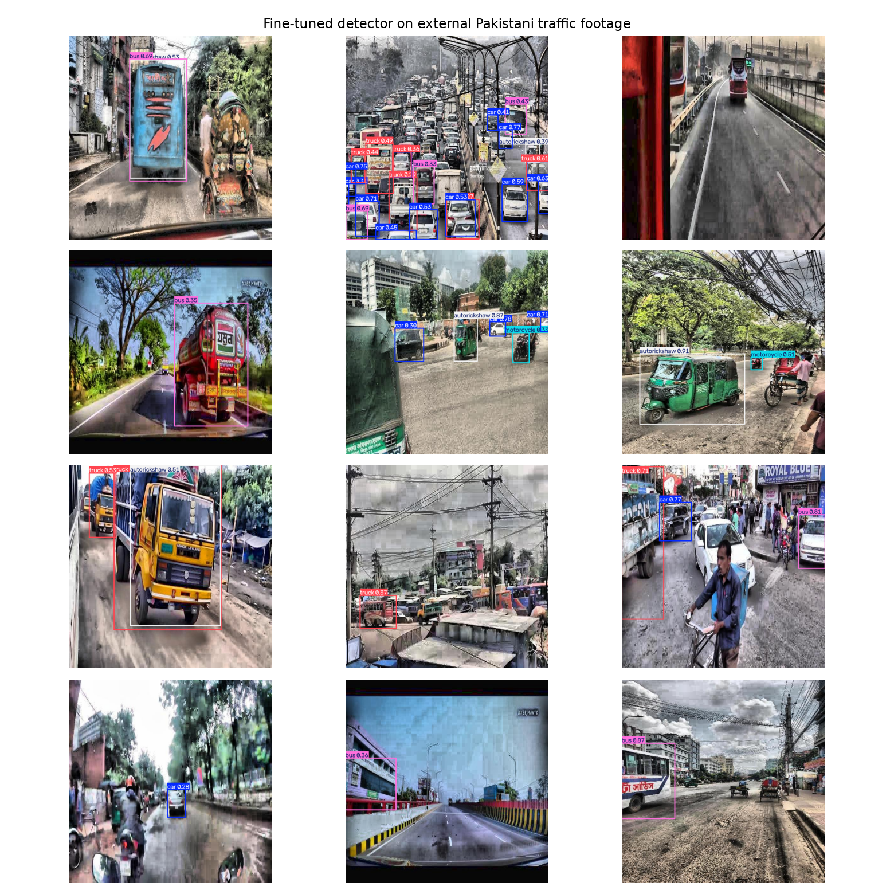
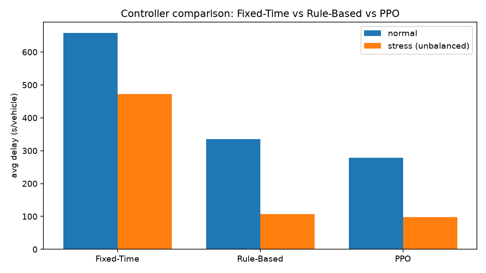

# Traffic Signal Timing Optimizer from Intersection Video

**Course:** AI2002 Artificial Intelligence - Semester Project (Fall 2026)
**Path:** A - Software-Based
**Campus / Section:** [CAMPUS / SECTION]
**Group Members:** [MEMBER 1 - ROLL NO], [MEMBER 2 - ROLL NO], [MEMBER 3 - ROLL NO]
**Instructor:** [INSTRUCTOR]
**Submission Date:** 06 December 2026

---

## 1. Problem Statement

Many intersections in Islamabad and Rawalpindi operate on fixed-time signal cycles that are set once and never adapt to actual traffic. Green time is regularly spent on empty approaches while a different approach queues for several cycles. This wastes fuel, increases delay and emissions, and worsens congestion. The core problem is that the signal does not know how much traffic is actually waiting on each approach.

## 2. Real-World Justification

Modern adaptive signal control systems are accurate but expensive, because they rely on buried inductive-loop sensors and dedicated controllers. A camera-based system needs no road works: it can run on existing CCTV or a single phone on a pole. This makes adaptive control practical for intersections where installing loop sensors is not feasible.

The stakeholder is a traffic engineer or municipal traffic operator. The decision they need to make is: *what green-time split should this intersection run for the next cycle to minimise total delay?* A network of such intersections affects daily commuters, fuel consumption and air quality.

## 3. Selected Path

Path A (Software-Based). The project implements a machine-learning detection pipeline combined with a traffic-engineering optimisation, deployed as a Streamlit application. It is not a CRUD system or a rule-based program with an AI label: the core signal depends on a trained neural network whose predictions feed the analysis and decision layers.

## 4. Objectives

1. Detect and classify vehicles from intersection footage using a trained object detector.
2. Convert raw detections into capacity-aware demand using Passenger Car Units (PCU).
3. Compute an optimal signal timing plan with Webster's method.
4. Quantify the delay reduction against the existing fixed-time plan.
5. Provide an interactive application demonstrating the complete flow.

## 5. Methodology

The system combines computer vision, traffic micro-simulation and reinforcement
learning:

1. **Model** - a fine-tuned YOLO detector localises and classifies vehicles.
2. **Analysis** - geometric lane ROIs and tracking produce de-duplicated per-lane counts, which are PCU-weighted and summarised as per-approach queue and arrival demand.
3. **Simulation** - the measured demand drives a SUMO four-approach intersection via TraCI.
4. **Decision** - three controllers are compared: a pre-timed **Fixed-Time** plan, a **Rule-Based** (actuated) plan, and a **PPO reinforcement-learning** agent that allocates green time adaptively. A Webster-based optimizer is also provided as a classical rule-based baseline for the delay comparison.

The layers are separated so each can be tested independently.

## 6. Algorithm Description

**Detection.** A single-stage convolutional detector is fine-tuned by transfer learning from COCO-pretrained weights on a merged dataset of seven vehicle classes. Fine-tuning is appropriate because the source imagery differs from COCO and because three target classes (autorickshaw, van, tractor) do not exist in COCO at all.

**Tracking.** Multi-object tracking (ByteTrack) assigns a persistent ID to each vehicle so that a vehicle is counted once per lane rather than once per frame.

**Lane counting.** Each lane is a polygon region of interest. A vehicle is assigned to the lane containing its ground-contact point, with a hysteresis state machine to prevent double counting.

**PCU weighting.** Each class is multiplied by a Passenger Car Unit factor (motorcycle 0.5, car 1.0, autorickshaw/van 1.5, tractor 3.0, bus/truck 3.5). A bus occupies far more road capacity than a motorcycle, so a naive vehicle count mis-estimates saturation.

**Queue and arrival analysis.** Per-approach halting queues and arrival rates are measured over a time window; these are the traffic indicators that drive the simulation and the controllers.

**Simulation.** SUMO micro-simulation (controlled through TraCI) models a four-approach intersection with two signal phases (North-South and East-West).

**Control.**
- *Fixed-Time*: alternates phases on a constant green time.
- *Rule-Based (actuated)*: extends green while the current phase is busier, switching once the other approach's queue exceeds a margin, with minimum and maximum green constraints.
- *PPO*: the agent observes per-approach halting queues plus the current phase and elapsed green, and chooses to keep or switch the phase. The reward is the negative total queue (minimising queue minimises delay). Proximal Policy Optimization is used, trained on CPU.

**Webster (classical baseline).** For the delay-reduction study, Webster's method computes an optimal cycle and green split:

```
Co = (1.5 * L + 5) / (1 - Y)          cycle length
g_i = (y_i / Y) * (Co - L)            effective green per phase
```

where `Y` is the sum of critical flow ratios and `L` the total lost time; greens are clamped to practical limits.

## 7. System Architecture



## 8. Dataset Description

- **Source:** Roboflow Universe (public datasets), merged from three sources:
  `thesis-swpxf/traffic-surveillance-system` (Public Domain),
  `amit-3ttxd/indian-traffic-objects` (CC BY 4.0),
  `image-detection-kwo9b/surveillance-system-rnklm` (CC BY 4.0).
- **Size:** 8,513 images (train 6,746 / val 962 / test 805), 21,275 annotated boxes.
- **Classes (7):** car, motorcycle, autorickshaw, van, tractor, bus, truck.
- **Preprocessing:** auto-orient, resize to 640x640; labels converted to a unified class index.
- **Limitations:** class imbalance (bus and van are thin classes); the source footage is video-derived, so train/test splits likely share visually similar frames; the imagery is not from Pakistani roads.

## 9. Implementation Details

- **Framework:** PyTorch 2.6, Ultralytics YOLOv8, OpenCV, Streamlit.
- **Hardware:** local NVIDIA T1200 (4 GB) for inference; training on Kaggle's free GPU, because the local GPU thermally throttles and shuts the laptop down under sustained load.
- **Model:** YOLOv8n fine-tuned for 7 classes; ~34 FPS inference at 640 px.
- **Code structure:** `src/models`, `src/analysis`, `src/decision`, `src/inference`, `app/`, `scripts/`, `tests/`.

## 10. Testing

- **Unit tests:** 32 automated tests covering ROI geometry, tracking de-duplication, PCU math, flow conversion, Webster, delay, and the app helpers (all passing).
- **Formula validation:** Webster's cycle and green split and the delay formula are checked against hand-worked textbook examples.
- **Representative inputs:** evaluation on a held-out test split; a qualitative domain-gap run on external footage.

## 11. Results

### 11.1 Detection accuracy (test split)

| Model | Classes | mAP@0.5 | mAP@0.5:0.95 |
|---|---|---|---|
| COCO zero-shot baseline | 4 | 0.727 | 0.549 |
| Fine-tuned (ours) | 7 | 0.944 | 0.782 |

Fine-tuning lifts mAP@0.5 by +0.217 and adds three classes COCO cannot detect at all.





### 11.2 Count accuracy

Counting is what the analysis layer actually consumes, so detection mAP alone is insufficient.

- MAE 0.395 vehicles/image, RMSE 0.992, bias +0.291, exact-count matches 74.8% (805 images).



### 11.3 PCU ablation

| Quantity | Naive count | PCU-weighted |
|---|---|---|
| flow P1 (PCU/h) | 1639 | 1410 |
| flow P2 (PCU/h) | 761 | 1043 |
| green P1 (s) | 26.1 | 23.0 |
| green P2 (s) | 12.1 | 17.0 |
| avg delay (s/veh) | 12.35 | 14.01 |

PCU weighting shifts green time by 3.1 s on P1 - the plan changes once roadside capacity is accounted for.

### 11.4 Signal optimisation (2-phase demonstration)

- Critical flow ratio Y = 0.645; optimised cycle 47.9 s.
- Fixed-time average delay 20.64 s/veh vs Webster 14.01 s/veh.
- **Delay reduction: 32.1%.**



### 11.5 Domain gap

On external Pakistani footage (300-image public set), the model averaged 2.53 detections/image and identified all seven classes including autorickshaw. The external labels are not usable for mAP, so this is a qualitative confirmation that the model still fires on local footage.



### 11.6 Adaptive control: Fixed-Time vs Rule-Based vs PPO

The measured demand drives a SUMO simulation in which three controllers are
compared (mean over two seeds):

**Normal demand**

| Controller | Avg queue | Avg delay (s/veh) | Throughput |
|---|---|---|---|
| Fixed-Time | 43.92 | 658.47 | 197.0 |
| Rule-Based | 49.65 | 335.57 | 166.0 |
| PPO | 47.09 | 279.00 | 147.5 |

**Stress demand (highly unbalanced)**

| Controller | Avg queue | Avg delay (s/veh) | Throughput |
|---|---|---|---|
| Fixed-Time | 22.24 | 472.83 | 136.0 |
| Rule-Based | 14.60 | 107.76 | 147.5 |
| PPO | 13.80 | 97.61 | 113.5 |

PPO reduces average delay versus Fixed-Time by **57.6% (normal)** and **79.4%
(stress)**. The stress scenario - deliberately unbalanced demand - is where
fixed-time control fails most and adaptive control helps most, which is exactly
the behaviour the study set out to demonstrate.



## 12. Limitations

- **Dataset imbalance:** bus and van are thin classes; per-class metrics are reported rather than overall accuracy.
- **Near-duplicate frames:** video-derived source data likely leaks visually similar frames across splits, so the 0.944 mAP is optimistic.
- **Domain gap:** training data is not from Pakistani roads. The external run is qualitative because of unusable labels; the magnitude of the gap must be measured with hand-labelled local footage.
- **PCU factors and saturation flow** are documented literature estimates (NOT VERIFIED against physical IRC:106-1990 document text) and not measured on-site.
- **Lane ROIs** are drawn manually; lane assignment is geometric, not learned.
- **Webster's method** is only valid under undersaturated conditions; the code flags oversaturation rather than returning a misleading plan.
- **RL reward** is a queue proxy for delay; the PPO throughput in some scenarios is lower than fixed-time because the episode ends with vehicles still in the network.
- The system is an **assistive prototype**, not a certified signal controller.

## 13. Conclusion and Future Work

The project shows an end-to-end adaptive signal system: a fine-tuned detector and tracking measure per-approach demand, PCU-aware analysis provides a faithful capacity measure, and a SUMO-simulated intersection is controlled by three controllers. Against a fixed-time baseline, the rule-based and (especially) the PPO reinforcement-learning controllers cut average delay substantially, with the largest gains under unbalanced demand (PPO: 57.6% normal, 79.4% stress).

Future work: hand-labelled local data to quantify the domain gap; coupling measured CV demand directly into live RL control; multi-intersection coordination; learned lane assignment; and edge deployment using the exported ONNX model.

---

## References

1. Webster, F. V. (1958). *Traffic Signal Settings*. Road Research Technical Paper No. 39, HMSO, London.
2. Jocher, G. et al. (2023). *Ultralytics YOLOv8*.
3. Zhang, Y. et al. (2022). *ByteTrack: Multi-Object Tracking by Associating Every Detection Box*.
4. Schulman, J. et al. (2017). *Proximal Policy Optimization Algorithms*. arXiv:1707.06347.
5. Lopez, P. A. et al. (2018). *Microscopic Traffic Simulation using SUMO*. IEEE ITSC.
6. Raffin, A. et al. (2021). *Stable-Baselines3: Reliable Reinforcement Learning Implementations*. JMLR.
7. Roboflow Universe datasets (see Section 8 for sources and licences).
